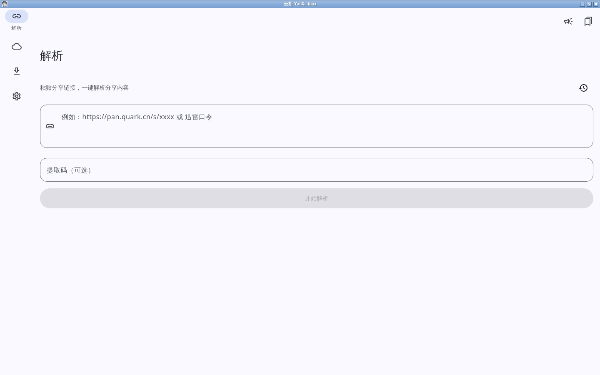
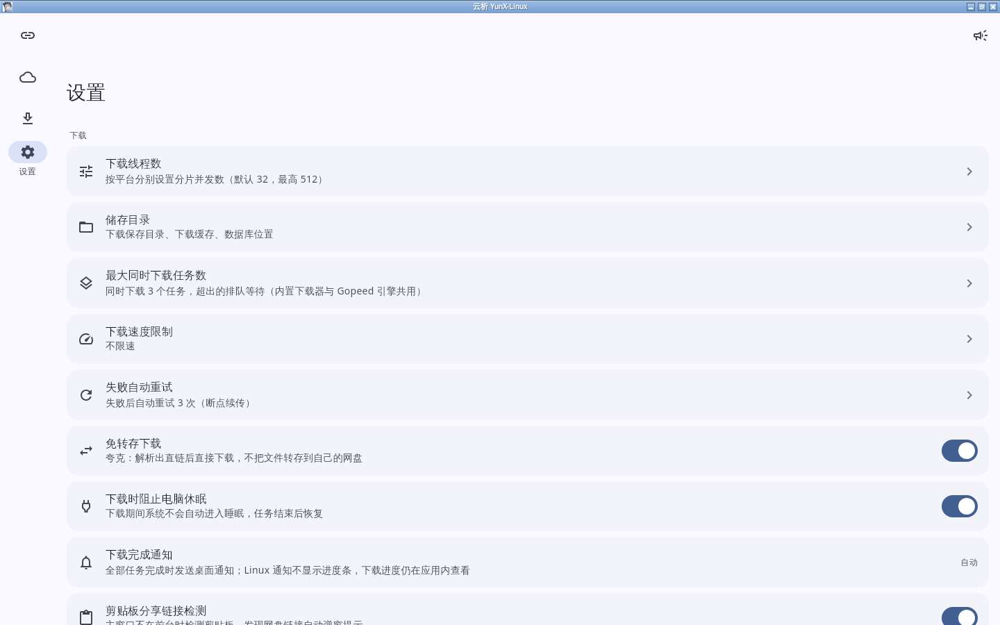
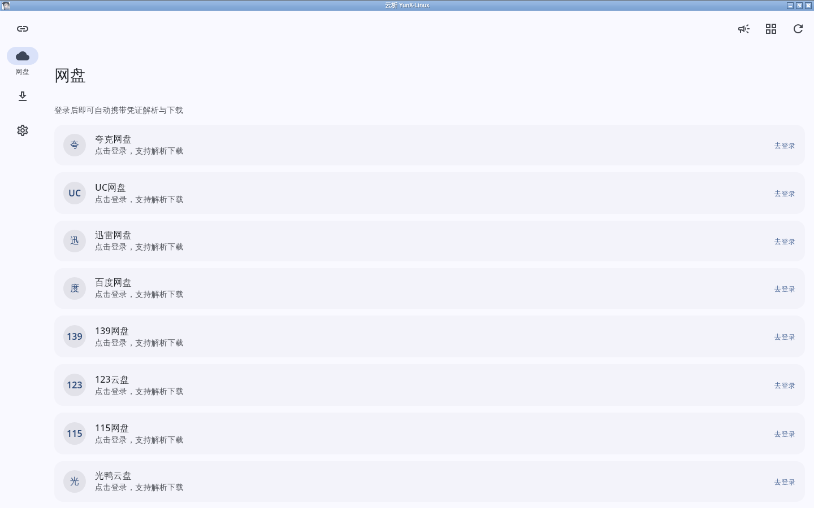
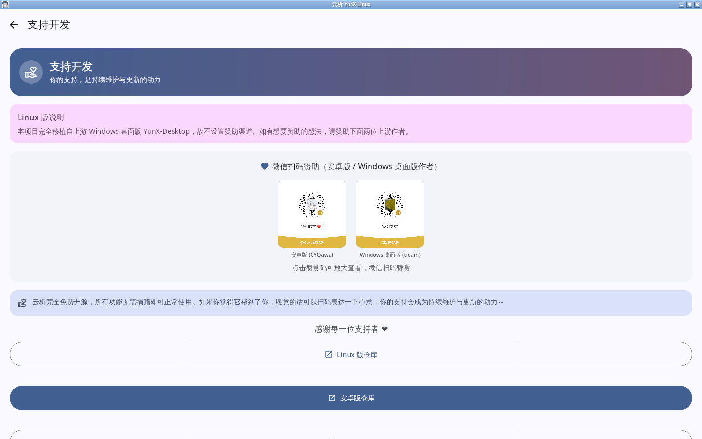
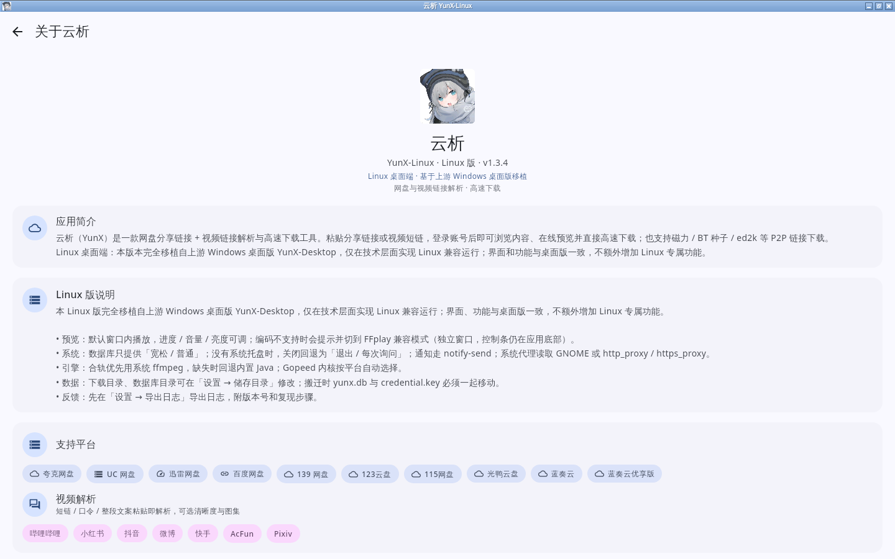

<div align="center">


# 云析 YunX-Linux · Linux 版

**云析 Linux 版（YunX-Linux）—— 粘贴分享链接，直接高速下载**

网盘：夸克 / UC / 迅雷 / 百度 / 139 / 123 / 115 / 光鸭 / 蓝奏云 / 蓝奏云优享版；
视频：哔哩哔哩 / 小红书 / 抖音 / 微博 / 快手 / AcFun / Pixiv；另支持磁力 / BT 种子 / ed2k 等 P2P 链接。
Range 分片并发 + 断点续传，B 站高清自动合轨。

[](./LICENSE)
[](#linux-版说明)
[](https://kotlinlang.org/)
[](https://www.jetbrains.com/lp/compose-multiplatform/)

[下载最新版](https://github.com/suz20090912-hub/YunX-Linux/releases/latest) · [功能](#功能) · [Linux 构建](docs/BUILD-LINUX.md) · [移植记录](docs/LINUX-PORT-FIXES.md) · [与安卓版差异](docs/UPSTREAM-DIFF.md)

</div>

***

> **云析永远免费开源。** 如果你是在任何地方「花钱买到」的，说明你被骗了，请立即退款。
> 任何收费版本均为二次打包的诈骗版本，与本项目无关。

> **本项目使用 AGPL-3.0 开源协议。** 与安卓版 [CYQawa/YunX](https://github.com/CYQawa/YunX)
> 同属云析项目；若你使用了本项目的代码，请同样以 AGPL-3.0 开放源代码。

## Linux 版说明

本仓库是 **云析 Linux 版（YunX-Linux）**，由上游 **Windows 桌面版 YunX-Desktop** 移植而来：

- Linux 版仓库：<https://github.com/suz20090912-hub/YunX-Linux>
- 上游 Windows 桌面版：[tidain/YunX-Desktop](https://github.com/tidain/YunX-Desktop)

> 仓库已由 `YunX-Desktop` 更名为 **`YunX-Linux`**，旧地址会由 GitHub 自动重定向。

- **完全移植自 Windows 桌面版**：界面、功能、交互与上游保持一致。
- **只在技术层面实现 Linux 兼容运行**：改动集中在宿主适配层（路径、权限、托盘、通知、代理、窗口焦点、CEF、播放器等），不额外增加 Linux 专属功能。
- **同源维护**：Linux 版与 Windows 桌面版共用同一套应用代码；应用层缺陷按上游行为保留，仅在 Linux 上单独修。
- **当前验证环境**：Ubuntu 22.04.5 LTS x86_64（构建与安装验收环境；24.04 的 `t64` 依赖已在 control 中做兼容）。其他 glibc 发行版可自行构建，未逐一实机验证。

## 界面截图

| Linux 主界面 | Linux 设置页 |
| --- | --- |
|  |  |

| Linux 网盘页 | Linux 支持开发页 |
| --- | --- |
|  |  |

| Linux 关于页 |
| --- |
|  |

## 安装

从 [Releases](https://github.com/suz20090912-hub/YunX-Linux/releases/latest) 下载 `.deb`：

```bash
sudo apt install ./yunx-desktop_<版本>_amd64.deb
```

或：

```bash
sudo dpkg -i yunx-desktop_<版本>_amd64.deb
sudo apt -f install
```

安装后从应用菜单启动「云析」，或执行：

```bash
yunx-desktop
```

`.deb` 的 `Depends` 已自动声明 GTK / NSS / GBM / X11 / ATK / cups / drm 等 JCEF 运行库；
`ffmpeg`、GStreamer 插件、`notify-send`、`wmctrl`、`xdotool` 作为 `Recommends`，`apt install` 默认会一并安装。
安装包自带 Java 运行时；`openjdk-17-jre` 只在源码构建或本机调试时需要。

如果使用 `apt install --no-install-recommends` 或最小化桌面环境，可手动补齐推荐组件：

```bash
sudo apt install ffmpeg libnotify-bin \
  gstreamer1.0-plugins-base gstreamer1.0-plugins-good \
  gstreamer1.0-libav wmctrl xdotool
```

## Linux 与 Windows 的差异

Linux 版不是另起一套功能，而是把 Windows 宿主能力换成 Linux 实现。以下是用户能感知到的差异：

| 项目 | Linux 行为 |
| --- | --- |
| 视频预览 | 默认在应用窗口内用内置 JavaFX 播放；编码不支持或初始化失败时自动切 FFplay 兼容模式（独立窗口，应用底部仍可控制进度/音量/亮度） |
| 数据库加密 | 只提供「宽松 / 普通」；Windows 的 DPAPI「较为严格」档在 Linux 不可用。从 Windows 迁来的 STRICT 配置会提示改档 |
| 系统托盘 | 有托盘环境可用；GNOME 等无托盘环境自动隐藏托盘选项，关闭时回退为直接退出，不会把窗口藏到无法恢复 |
| 桌面通知 | 使用 `notify-send`，只发完成通知，不显示 Windows 通知中心那种进度条 |
| 系统代理 | 读取 GNOME 网络设置或 `http_proxy` / `https_proxy` 环境变量；未配置按直连处理 |
| 下载引擎 | Gopeed 内核按平台自动选择固定版本；合轨优先系统 `ffmpeg`，缺失时回退内置 Java |
| 窗口激活 | 二次启动优先 X11 `XRaiseWindow` / `XSetInputFocus`，失败回退 `wmctrl` / `xdotool` |
| 数据目录 | `~/.yunx-desktop`（数据库、凭证、日志、Gopeed 引擎）；下载目录默认 `~/下载` |
| 安装包 | `.deb`，不提供 Windows 的便携版 / Inno Setup 安装包 |

完整技术细节与修复记录见 **[Linux 移植记录](docs/LINUX-PORT-FIXES.md)**。

## 功能

- **分享链接解析** —— 识别夸克 / UC / 迅雷 / 百度 / 139 / 123 / 115 / 光鸭 / 蓝奏云 / 蓝奏云优享版 分享链接并自动匹配提取码，另支持 GitHub 仓库 / 账号 / 文件直链
- **视频解析与预览** —— 抖音 / 快手 / 微博 / 小红书 / B站 / AcFun / Pixiv 作品链接（短链、口令、整段文案均可）；Linux 默认窗口内预览，编码不支持时切 FFplay；图集可放大，下载支持 DASH 合轨与 Live Photo 合成
- **高速下载** —— Range 分片并发 + 断点续传 + 慢连接自动换线 + 全局限速；B 站高清分轨两轨并行下载后自动合轨
- **P2P 下载** —— 磁力 / BT 种子 / ed2k 交给 Gopeed 引擎；支持导入 `.torrent`、Tracker 管理与 DHT 开关
- **GitHub 浏览与 README 渲染** —— 浏览仓库文件树 / Releases / 账号仓库列表，README 与更新说明以 GFM Markdown 渲染
- **GitHub 下载镜像自动测速** —— 内置 gh-proxy 系镜像，按延迟与下载速度自动选择；更新包 / 引擎 / 内核 / README 图片统一走镜像
- **多种登录方式** —— 内嵌 Chromium 登录 / 导入本机浏览器 Cookie / 手动粘贴 Cookie；GitHub 可选 Personal Access Token
- **多账号与认证备份** —— 网盘与视频平台多账号；「设置 → 认证备份」可加密导出 / 导入全部账号
- **桌面体验** —— 深色模式 + 自定义种子色、链接收藏、解析历史、窗口内弹窗覆盖层
- **引擎管理** —— Gopeed 内核与 FFmpeg 预览引擎集中管理，可下载 / 更新 / 卸载并查看路径与来源

完整功能清单见 **[功能清单](docs/FEATURES.md)**。

## 数据目录与日志

| 路径 | 内容 |
| --- | --- |
| `~/.yunx-desktop/` | 应用数据目录（权限 700） |
| `~/.yunx-desktop/yunx.db` | SQLite 数据库（权限 600） |
| `~/.yunx-desktop/credential.key` | 凭证加密密钥；搬迁数据目录时必须一起带走 |
| `~/.yunx-desktop/gopeed/` | Gopeed 引擎与 `engine.pid` |
| `~/.yunx-desktop/files/yunx-desktop.log` | 运行日志 |

反馈问题前，建议先在应用内「导出日志」，不要直接上传包含 Cookie / Token 的数据库或凭证文件。

## 从源码构建

Linux 构建步骤、依赖和打包产物见 **[Linux 构建](docs/BUILD-LINUX.md)**。最短流程：

```bash
sudo apt install openjdk-17-jre ffmpeg fakeroot
./gradlew :desktop:compileKotlin
./gradlew :desktop:packageDeb
```

产物在：

```text
desktop/build/compose/binaries/main/deb/
```

仓库已包含 Gradle Wrapper；如果 `./gradlew` 没有执行权限：

```bash
chmod +x gradlew
```

Windows 桌面版的原有构建方式仍保留在 **[构建与打包（Windows）](docs/BUILD.md)**。

## 已知限制

- 内置 JavaFX 对部分容器/编码兼容性有限，失败会自动切 FFplay；FFplay 在 Linux 无法嵌入应用窗口，会另开独立窗口。
- 数据库加密不提供 Windows DPAPI 档；Linux 使用机器指纹派生密钥，换机或改 `/etc/machine-id` 后需要重新登录。
- Chrome / Chromium 127+ 的 v20 应用绑定 Cookie 无法解密；可用 Firefox 导入，或直接在内嵌浏览器登录。
- GNOME 等无 XEmbed 托盘的环境不保证显示托盘图标，已做通知兜底。
- 更新检查在 Linux 上只查询 Linux 版仓库的 Releases，并只匹配 Linux 资产命名（`.deb` / `.AppImage` / `.rpm` / `.tar.gz` / `.tar.xz`）；发布页命名需保持一致。
- 其他视频平台尚未逐一实机验证。

## 文档

| 文档 | 内容 |
| --- | --- |
| [功能清单](docs/FEATURES.md) | 全部功能与细节 |
| [使用说明](docs/USAGE.md) | 快速上手、登录方式、设置项、数据目录、托盘操作 |
| [Linux 构建](docs/BUILD-LINUX.md) | Linux 依赖、编译、打包、产物 |
| [Windows 构建](docs/BUILD.md) | 上游 Windows 桌面版的构建方式 |
| [Linux 移植记录](docs/LINUX-PORT-FIXES.md) | 平台适配、播放器、下载链路、文案调整与验证结果 |
| [Linux 验收记录](docs/VM-ACCEPTANCE.md) | Ubuntu 安装、启动、界面与依赖验收 |
| [更新日志](CHANGELOG.md) | Linux 版版本变化 |
| [与安卓版的差异](docs/UPSTREAM-DIFF.md) | 桌面版相对安卓版的新增 / 重做 / 移除 |
| [免责声明](docs/DISCLAIMER.md) | 免责声明、协议逆向说明、反倒卖、开源协议 |

## 赞助说明

本项目由于完全移植于 desktop 版，故**不设置赞助渠道**。如有想要赞助的想法，请赞助下面两位上游作者：

- 安卓版作者：[CYQawa](https://github.com/CYQawa)
- Windows 桌面版作者：[tidain](https://github.com/tidain)

应用内「支持开发」页可直接扫码赞赏，所有功能无需捐赠即可正常使用。

## 开源协议

本项目与安卓版 [CYQawa/YunX](https://github.com/CYQawa/YunX) 同属云析项目，同样以
[GNU AGPL-3.0](https://www.gnu.org/licenses/agpl-3.0.html) 协议开源，详见 [LICENSE](LICENSE)。
完整的免责与合规说明见 **[免责声明](docs/DISCLAIMER.md)**。

## 更多

- Linux 版仓库：<https://github.com/suz20090912-hub/YunX-Linux>
- 上游 Windows 桌面版：<https://github.com/tidain/YunX-Desktop>
- 安卓版：<https://github.com/CYQawa/YunX>
- 问题与建议：<https://github.com/suz20090912-hub/YunX-Linux/issues>
- 云析 Docker 社区移植版：<https://github.com/mu-zi-lee/YunX-Docker>

## 贡献者

<a href="https://github.com/tidain/YunX-Desktop/graphs/contributors">
  
</a>
